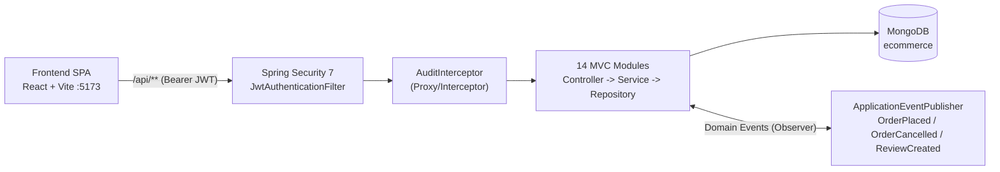

# 📘 HƯỚNG DẪN DỰ ÁN E-COMMERCE & PHÂN CÔNG NHÓM (5 THÀNH VIÊN)

Tài liệu này dành cho 5 thành viên nhóm (**Thật, Toại, Quang, An, Tấn**) để:
1. Cài đặt môi trường, clone 2 repository (Backend + Frontend) và chạy hệ thống trên máy cá nhân.
2. Nắm rõ phân công module, nhánh Git và **cách triển khai chi tiết từng Design Pattern trong code** để phát triển tiếp và bảo vệ đồ án môn **Software Architecture**.

---

## 1. Tổng quan Kiến trúc Hệ thống

- **Kiến trúc tổng thể:** **Spring Boot MVC (chia theo Package-by-Feature / Modular Monolith)** + **Event-Driven (Spring Domain Events)** + **SPA Frontend tách riêng**.
- **Backend Repo:** `https://github.com/ThanhThat12/KTPM_Ecommerce.git` (Java 21, Spring Boot 4.2.0, Spring Security 7, Spring Data MongoDB, chạy cổng `8082`).
- **Frontend Repo:** `https://github.com/ThanhThat12/e-commerce-frontend.git` (React 18, Vite 5, Tailwind CSS, chạy cổng `5173`, tự proxy `/api` → `http://localhost:8082`).
- **Cơ sở dữ liệu:** MongoDB (`mongodb://localhost:27017/ecommerce`).



---

## 2. Hướng dẫn Cài đặt & Chạy từ đầu (cho mọi thành viên)

### Bước 1: Cài đặt công cụ cần thiết
1. **JDK 21** (Oracle JDK 21 hoặc Eclipse Temurin 21).
2. **MongoDB Community Server** (chạy service tại `localhost:27017`).
3. **Node.js 18+** (kèm `npm`).
4. **IntelliJ IDEA** (cho Backend) & **VS Code** (cho Frontend).
5. **Git** đã đăng nhập tài khoản GitHub của bạn.

### Bước 2: Clone 2 Repository và chuyển sang nhánh `dev`

```powershell
# 1. Tạo thư mục chung chứa dự án
mkdir e-commerce-workspace
cd e-commerce-workspace

# 2. Clone Backend và chuyển sang nhánh dev
git clone https://github.com/ThanhThat12/KTPM_Ecommerce.git e-commerce
cd e-commerce
git checkout dev
cd ..

# 3. Clone Frontend và chuyển sang nhánh dev
git clone https://github.com/ThanhThat12/e-commerce-frontend.git
cd e-commerce-frontend
git checkout dev
```

### Bước 3: Mở và chạy Backend (cổng `8082`)
1. Mở thư mục `e-commerce` bằng **IntelliJ IDEA**.
2. **Lưu ý quan trọng nếu IntelliJ báo lỗi Maven Guice (`No implementation for ArtifactHandlerManager was bound`) hoặc `JVM target 5`:**
   - Vào **File → Settings (`Ctrl + Alt + S`) → Build, Execution, Deployment → Build Tools → Maven**.
   - Đổi **Maven home path** từ *Use Maven wrapper* sang **`Bundled (Maven 3)`** → **Apply → OK**.
   - Mở tab **Maven** bên phải → bấm **Reload All Maven Projects**.
   - Kiểm tra **Project Structure (`Ctrl + Alt + Shift + S`)**: Project SDK = **21**, Language level = **21**.
3. Đảm bảo MongoDB đang chạy ở `mongodb://localhost:27017/ecommerce`.
4. Chạy file `src/main/java/com/example/ecommerce/ECommerceApplication.java` (hoặc chạy lệnh):
   ```powershell
   cd e-commerce
   .\mvnw.cmd spring-boot:run
   ```
5. Thấy dòng log `Tomcat started on port 8082 (http)` và `Default ADMIN account seeded: admin@ecommerce.com` là **thành công**.

### Bước 4: Chạy Frontend (cổng `5173`)
```powershell
cd e-commerce-frontend
npm install
npm run dev
```
Mở trình duyệt tại: **http://localhost:5173**

### Bước 5: Chạy Unit Tests kiểm tra Design Patterns
```powershell
cd e-commerce
.\mvnw.cmd test "-Dtest=OrderStateTest,PriceCalculatorTest,JwtServiceTest"
```

### Bước 6: Quy trình Git làm việc nhóm (bắt buộc)
> Nhánh `dev` trên GitHub đã bật **Ruleset** — không ai được push trực tiếp vào `dev`, mọi thay đổi phải đi qua **Pull Request** để Lead duyệt.

```powershell
# Luôn cập nhật dev mới nhất trước khi code
git checkout dev
git pull origin dev

# Tạo nhánh tính năng của bạn từ dev
git checkout -b feat/<ten-module>-<mo-ta-ngan>

# Code, commit theo chuẩn Conventional Commits
git add .
git commit -m "feat(product): add inventory alert threshold"

# Đẩy nhánh của bạn lên GitHub và mở Pull Request -> dev
git push -u origin feat/<ten-module>-<mo-ta-ngan>
```

### Tài khoản mẫu để test hệ thống
- **Admin (tự tạo khi khởi động):** `admin@ecommerce.com` / `Admin@123`
- **Khách hàng:** Đăng ký trực tiếp tại trang `/auth` (hoặc dùng `vip@shoparch.vn` / `Password@123` nếu đã seed).

---

## 3. Phân công Chi tiết cho 5 Thành viên & Hướng dẫn Design Patterns

### Bảng tổng hợp phân công (Random cân bằng khối lượng & Pattern)

| Thành viên | Cụm Module Backend | Nhánh Git liên quan | Trang Frontend phụ trách | Design Patterns thuyết trình |
|---|---|---|---|---|
| **Quang** | `common`, `security`, `user`, `audit` | `feat/user`, `feat/auth-security`, `feat/security-audit-tests` | `AuthPage`, `ProfilePage`, `client.js`, `AuthContext`, `Admin [Users & Audit]` | **Builder**, **Singleton**, **Chain of Responsibility (Filter)**, **Interceptor / Proxy** |
| **An** | `product`, `review`, `search` | `feat/product`, `feat/review-search` | `ShopPage` (Search, Grid, Review Modal), `Admin [Catalog]` | **Builder**, **Observer (Subscriber)**, **Specification / Criteria** |
| **Tấn** | `cart`, `wishlist`, `flashsale` | `feat/cart`, `feat/wishlist-flashsale` | `WishlistPage`, `CartCheckoutPage` (Cart & Voucher), `ShopPage` (Flash Sale), `Admin [Promo]` | **Strategy**, **Decorator** |
| **Thật** | `order`, `shipping` | `feat/order`, `feat/shipping` | `CartCheckoutPage` (Checkout & Quotes), `OrdersPage`, `Admin [Orders & Shipping]` | **Facade**, **State**, **Chain of Responsibility**, **Observer (Publisher)**, **Strategy + Adapter + Factory** |
| **Toại** | `payment`, `notification`, `analytics`, `media` | `feat/payment-notification`, `feat/analytics-media` | `NotificationsPage`, `Admin [Analytics & Media Upload]` | **Factory Method**, **Adapter**, **Observer (Subscriber)**, **Template Method** |

---

### 👤 THÀNH VIÊN 1: QUANG — Security, Auth, User & Audit

**Phạm vi code:**
- Backend: `common/`, `user/`, `audit/`
- Frontend: `src/api/client.js`, `src/context/AuthContext.jsx`, `src/components/ProtectedRoute.jsx`, `src/pages/AuthPage.jsx`, `src/pages/ProfilePage.jsx`, tab `Người dùng` & `Audit Logs` trong `AdminDashboardPage.jsx`.

**Chi tiết các Design Pattern đã cài đặt trong code:**

1. **Builder Pattern** (`common/response/ApiResponse.java`, `user/model/User.java`)
   - **Bài toán:** Response JSON và đối tượng `User` có nhiều trường tùy chọn (`data`, `message`, `timestamp`, `addresses`, `role`). Dùng nhiều constructor sẽ rối và khó đọc.
   - **Cách cài đặt:** Dùng `@Builder` + `@Builder.Default` kết hợp các static factory method `ApiResponse.ok(...)`, `ApiResponse.created(...)`, `ApiResponse.error(...)`.
   - **Trong code:** Mọi Controller đều trả `ApiResponse.ok(...)` giúp chuẩn hóa 100% format phản hồi JSON.

2. **Chain of Responsibility Pattern — Security Filter Chain** (`common/security/JwtAuthenticationFilter.java`, `common/security/SecurityConfig.java`)
   - **Bài toán:** Mọi HTTP request đến API đều phải đi qua nhiều bước kiểm tra liên tiếp (CORS → xác thực JWT → kiểm tra blacklist → kiểm tra phân quyền Role → Controller).
   - **Cách cài đặt:** `JwtAuthenticationFilter` kế thừa `OncePerRequestFilter`, đọc header `Authorization: Bearer <token>`, kiểm tra `tokenBlacklistService.isBlacklisted(token)`, gọi `jwtService.parseAndValidate(token)` rồi nạp `AuthenticatedUser` vào `SecurityContextHolder`, sau đó gọi `filterChain.doFilter(request, response)` để chuyển tiếp cho mắt xích kế tiếp.
   - **Đăng ký chuỗi:** Trong `SecurityConfig.securityFilterChain(...)` gọi `.addFilterBefore(jwtAuthenticationFilter, UsernamePasswordAuthenticationFilter.class)`.

3. **Interceptor / Proxy Pattern** (`audit/service/AuditInterceptor.java`, `common/config/WebConfig.java`)
   - **Bài toán:** Cần ghi nhật ký (Audit Log) cho mọi thao tác thay đổi dữ liệu (`POST`, `PUT`, `PATCH`, `DELETE`) mà không phải chèn code ghi log lặp lại vào từng Controller.
   - **Cách cài đặt:** `AuditInterceptor` cài đặt `HandlerInterceptor`, override `afterCompletion(...)` để tự động lấy thông tin user từ `SecurityContextHolder` và lưu `AuditLog` vào MongoDB. Đăng ký 1 lần duy nhất trong `WebConfig.addInterceptors(...)`.

4. **Refresh Token Rotation & Blacklist** (`common/security/RefreshTokenService.java`, `TokenBlacklistService.java`, `user/controller/AuthSessionController.java`)
   - **Luồng chạy:** Khi `POST /api/auth/refresh`, hệ thống kiểm tra refresh token cũ → thu hồi token cũ (`revoke`) → cấp cặp access + refresh token mới. Khi `POST /api/auth/logout`, access token bị đưa vào `TokenBlacklistService` (tự dọn bằng `@Scheduled`) và toàn bộ refresh token của user bị vô hiệu hóa.
   - **Unit Test:** `src/test/java/com/example/ecommerce/common/JwtServiceTest.java`.

---

### 👤 THÀNH VIÊN 2: AN — Product, Category, Review & Search

**Phạm vi code:**
- Backend: `product/`, `review/`, `search/`
- Frontend: `src/pages/ShopPage.jsx` (thanh lọc, lưới sản phẩm, phân trang, modal đánh giá), tab `Sản phẩm & Ảnh` trong `AdminDashboardPage.jsx`.

**Chi tiết các Design Pattern đã cài đặt trong code:**

1. **Builder Pattern** (`product/model/Product.java`, `product/model/Category.java`)
   - **Bài toán:** `Product` có nhiều thuộc tính tùy chọn (`imageUrls`, `attributes`, `averageRating`, `reviewCount`, `active`).
   - **Cách cài đặt:** `ProductService.createProduct(...)` dùng `Product.builder()...build()` để khởi tạo rõ ràng, an toàn giá trị mặc định.

2. **Observer Pattern — Event Subscribers** (`product/service/ProductInventoryListener.java`, `product/service/ProductRatingListener.java`)
   - **Bài toán:** Module `order` và `review` không nên gọi trực tiếp vào `ProductRepository` để sửa tồn kho hay điểm đánh giá vì sẽ tạo phụ thuộc vòng (circular dependency).
   - **Cách cài đặt:**
     - `ProductInventoryListener` dùng `@EventListener` lắng nghe `OrderPlacedEvent` (tự động gọi `productService.deductStock(...)`) và `OrderCancelledEvent` (tự động gọi `productService.restoreStock(...)`).
     - `ProductRatingListener` dùng `@EventListener` lắng nghe `ReviewCreatedEvent` (do `ReviewService` phát ra sau khi kiểm tra khách đã có đơn `DELIVERED`) để tự tính lại `averageRating` và `reviewCount` của sản phẩm.

3. **Specification / Criteria Pattern** (`search/service/ProductSpecification.java`, `search/service/ProductSearchService.java`)
   - **Bài toán:** Người dùng có thể kết hợp tùy ý 6 bộ lọc (từ khóa, danh mục, giá min, giá max, sao tối thiểu, còn hàng) + sắp xếp + phân trang. Nếu viết các hàm `findBy...` trong `MongoRepository` sẽ bùng nổ hàng chục method.
   - **Cách cài đặt:** `ProductSpecification.buildQuery(ProductSearchCriteria)` nhận DTO tiêu chí lọc, kiểm tra từng điều kiện khác `null` để ghép động vào danh sách `Criteria` rồi kết hợp bằng `andOperator(...)`. `ProductSearchService` thực thi `Query` qua `MongoTemplate` kèm `PageRequest` + whitelist trường sắp xếp an toàn.

---

### 👤 THÀNH VIÊN 3: TẤN — Cart, Voucher, Wishlist & Flash Sale

**Phạm vi code:**
- Backend: `cart/`, `wishlist/`, `flashsale/`
- Frontend: `src/pages/WishlistPage.jsx`, phần Giỏ hàng & Voucher trong `CartCheckoutPage.jsx`, banner Flash Sale trong `ShopPage.jsx`, tab `Voucher & Flash Sale` trong `AdminDashboardPage.jsx`.

**Chi tiết các Design Pattern đã cài đặt trong code:**

1. **Strategy Pattern — Thuật toán giảm giá** (`cart/service/pricing/DiscountStrategy.java`, `PercentageDiscountStrategy.java`, `FixedAmountDiscountStrategy.java`)
   - **Bài toán:** Hệ thống có nhiều loại mã giảm giá (giảm theo % có trần giảm tối đa, giảm số tiền cố định, sau này có thể thêm mua 2 tặng 1...). Không nên viết `if/else` chằng chịt trong `CartService`.
   - **Cách cài đặt:**
     - Interface `DiscountStrategy` định nghĩa `calculateDiscount(BigDecimal amount, Voucher voucher)`.
     - `PercentageDiscountStrategy`: tính `amount * % / 100` và giới hạn bởi `maxDiscountAmount`.
     - `FixedAmountDiscountStrategy`: giảm trực tiếp `discountValue` (không vượt quá `amount`).
     - `CartService.resolveStrategy(DiscountType)` chọn đúng chiến lược theo loại Voucher.

2. **Decorator Pattern — Tính giá nhiều lớp** (`cart/service/pricing/PriceCalculator.java`, `BasePriceCalculator.java`, `PriceDecorator.java`, `VoucherDiscountDecorator.java`, `VipDiscountDecorator.java`, `ShippingFeeDecorator.java`)
   - **Bài toán:** Giá cuối cùng của giỏ hàng có thể cộng/trừ nhiều lớp linh hoạt tùy điều kiện (giá gốc → giảm Voucher → giảm thêm 5% nếu là khách `VIP` → cộng 30.000₫ phí ship nếu dưới 500.000₫ hoặc miễn phí ship nếu từ 500.000₫ trở lên), đồng thời phải hiển thị chi tiết từng dòng giải thích (`priceBreakdown`).
   - **Cách cài đặt:** Trong `CartService.buildSummary(...)`:
     ```java
     PriceCalculator calculator = new BasePriceCalculator(subtotal);
     if (hasVoucher) calculator = new VoucherDiscountDecorator(calculator, voucher, strategy);
     if (user.getRole() == UserRole.VIP) calculator = new VipDiscountDecorator(calculator);
     if (!cart.getItems().isEmpty()) calculator = new ShippingFeeDecorator(calculator);
     ```
     Mỗi Decorator bọc lớp trước đó, tự tính `calculate()` và nối thêm dòng diễn giải vào `describeBreakdown()`.
   - **Unit Test:** `src/test/java/com/example/ecommerce/cart/PriceCalculatorTest.java`.

3. **Scheduled Task trong Flash Sale** (`flashsale/service/FlashSaleService.java`)
   - Method `deactivateExpiredSales()` gắn `@Scheduled(fixedRate = 60000)` tự động kiểm tra và tắt các đợt Flash Sale đã quá `endTime` mỗi phút.

---

### 👤 THÀNH VIÊN 4: THẬT — Order, Checkout & Shipping

**Phạm vi code:**
- Backend: `order/`, `shipping/`
- Frontend: phần Checkout & Báo giá vận chuyển trong `CartCheckoutPage.jsx`, `src/pages/OrdersPage.jsx`, tab `Đơn hàng & Vận đơn` trong `AdminDashboardPage.jsx`.

**Chi tiết các Design Pattern đã cài đặt trong code:**

1. **Facade Pattern** (`order/service/facade/CheckoutFacade.java`)
   - **Bài toán:** Quy trình đặt hàng chạm tới 6 thành phần (`UserService`, `CartService`, `ProductService`, `PaymentService`, `OrderRepository`, `OrderStateResolver`, `ApplicationEventPublisher`). Nếu đặt ở Controller sẽ gây "Fat Controller" cực kỳ rối.
   - **Cách cài đặt:** `CheckoutFacade.checkout(CheckoutRequest)` cung cấp đúng **1 hàm duy nhất** cho `OrderController`, bên trong điều phối trọn vẹn 5 bước: Validate chuỗi → Tính giá → Lưu đơn `PENDING` → Gọi thanh toán & chuyển trạng thái `PAID` → Xóa giỏ & phát sự kiện `OrderPlacedEvent`.

2. **Chain of Responsibility Pattern — Chuỗi kiểm tra Checkout** (`order/service/validation/CheckoutValidationHandler.java`, `CartNotEmptyValidator.java`, `ShippingAddressValidator.java`, `StockAvailabilityValidator.java`)
   - **Bài toán:** Trước khi đặt hàng phải kiểm tra nhiều điều kiện độc lập; cần dễ dàng thêm bước kiểm tra mới (vd: chống gian lận, giới hạn đơn/ngày) mà không sửa code cũ.
   - **Cách cài đặt:** `CheckoutValidationHandler` giữ tham chiếu `next` với phương thức `linkWith(...)`. Trong `CheckoutFacade`:
     ```java
     CheckoutValidationHandler chain = new CartNotEmptyValidator();
     chain.linkWith(new ShippingAddressValidator())
          .linkWith(new StockAvailabilityValidator(productService));
     chain.validate(new CheckoutContext(user, cart, request));
     ```

3. **State Pattern — Vòng đời trạng thái đơn hàng** (`order/service/state/OrderState.java`, `PendingOrderState`, `PaidOrderState`, `ShippingOrderState`, `DeliveredOrderState`, `CancelledOrderState`, `OrderStateResolver`)
   - **Bài toán:** Đơn hàng có quy tắc chuyển trạng thái nghiêm ngặt (`PENDING → PAID → SHIPPING → DELIVERED`, chỉ được `CANCELLED` khi còn `PENDING` hoặc `PAID`).
   - **Cách cài đặt:** Interface `OrderState` mặc định ném `BusinessException(INVALID_ORDER_STATE)` cho mọi hành động không hợp lệ. Mỗi class trạng thái chỉ override những hành động được phép (vd: `PaidOrderState` chỉ cho `ship()` và `cancel()`; `DeliveredOrderState` không cho chuyển tiếp nữa). `OrderStateResolver` dùng `EnumMap` ánh xạ `OrderStatus → OrderState`.
   - **Unit Test:** `src/test/java/com/example/ecommerce/order/OrderStateTest.java`.

4. **Observer Pattern — Event Publisher** (`CheckoutFacade.java`, `OrderService.java`)
   - Phát `OrderPlacedEvent` khi đặt hàng và `OrderCancelledEvent` khi hủy đơn qua `ApplicationEventPublisher` để tách rời hoàn toàn khỏi `product` và `notification`.

5. **Strategy + Adapter + Factory Method trong Shipping** (`shipping/service/strategy/`, `adapter/`, `factory/`)
   - **Strategy:** `StandardShippingStrategy` vs `ExpressShippingStrategy` tính cước theo cân nặng & thành phố.
   - **Adapter:** `GhnCarrierAdapter`, `GhtkCarrierAdapter`, `ExpressCarrierAdapter` chuẩn hóa API của các hãng vận chuyển về chung `ShippingCarrierAdapter`.
   - **Factory Method:** `ShippingCarrierFactory` tự động gom các bean `ShippingCarrierAdapter` vào `EnumMap` để `ShippingService` lấy đúng hãng theo `ShippingCarrier`.

---

### 👤 THÀNH VIÊN 5: TOẠI — Payment, Notification, Analytics & Media

**Phạm vi code:**
- Backend: `payment/`, `notification/`, `analytics/`, `media/`
- Frontend: `src/pages/NotificationsPage.jsx`, tab `Thống kê` và tính năng Upload ảnh trong `AdminDashboardPage.jsx`.

**Chi tiết các Design Pattern đã cài đặt trong code:**

1. **Adapter Pattern — Cổng thanh toán & Lưu trữ file**
   - **Payment (`payment/service/adapter/`):** Interface `PaymentGatewayAdapter` chuẩn hóa `charge(...)` và `refund(...)` cho 3 cổng khác nhau: `CodPaymentAdapter` (trả `PENDING`), `VnPayPaymentAdapter` (trả `COMPLETED`), `MoMoPaymentAdapter` (trả `COMPLETED`).
   - **Media (`media/service/storage/`):** Interface `StorageAdapter` chuẩn hóa `store`, `load`, `delete`. Hiện triển khai `LocalFileStorageAdapter` (chống path traversal, lưu tên file UUID an toàn); khi lên production chỉ cần viết thêm `CloudinaryStorageAdapter` hoặc `S3StorageAdapter` mà không sửa `MediaService`.

2. **Factory Method Pattern** (`payment/service/factory/PaymentGatewayFactory.java`, `notification/service/factory/NotificationSenderFactory.java`)
   - **Bài toán:** Cần tạo/lấy đúng đối tượng xử lý thanh toán (`COD`/`VNPAY`/`MOMO`) hoặc kênh gửi thông báo (`EMAIL`/`IN_APP`) tại runtime mà không dùng `switch/case` cứng.
   - **Cách cài đặt:** Inject `List<PaymentGatewayAdapter>` (và `List<NotificationSender>`) từ Spring IoC container vào `EnumMap`. Khi thêm phương thức mới (vd: `STRIPE` hoặc `SMS`), chỉ cần tạo 1 class `@Component` mới — tuân thủ triệt để nguyên lý **Open/Closed Principle (OCP)**.

3. **Observer Pattern — Notification Subscriber** (`notification/service/OrderNotificationListener.java`)
   - Lắng nghe `OrderPlacedEvent` và `OrderCancelledEvent` bằng `@EventListener`, tự động gửi đồng thời cả 2 kênh `EMAIL` và `IN_APP` thông qua `NotificationService` & `NotificationSenderFactory`.

4. **Template Method Pattern — Báo cáo thống kê** (`analytics/service/template/AbstractReportGenerator.java`, `RevenueReportGenerator.java`, `OrderStatusReportGenerator.java`)
   - **Bài toán:** Mọi báo cáo trong Admin Dashboard đều tuân theo quy trình cố định: Lấy dữ liệu thô → Tổng hợp chỉ số → Đóng gói `ReportResponse` kèm tên báo cáo và thời gian sinh.
   - **Cách cài đặt:** `AbstractReportGenerator<T>` khai báo phương thức `public final ReportResponse generate()` cố định khung thuật toán, gọi các bước abstract `reportName()`, `fetchRawData()`, `aggregateMetrics(...)` để các lớp con `RevenueReportGenerator` và `OrderStatusReportGenerator` tự cài đặt chi tiết.

---

## 4. Kịch bản Demo 5 phút khi Bảo vệ Đồ án

1. **Quang (1 phút):** Mở `http://localhost:5173/auth`, đăng ký tài khoản mới → minh họa gọi API Admin bị chặn `403`, đăng nhập Admin (`admin@ecommerce.com`), chỉ `Audit Logs` ghi tự động mọi thao tác.
2. **An (1 phút):** Ra trang Cửa hàng, lọc sản phẩm theo từ khóa/giá/sao (`Specification`), mở modal xem đánh giá `5.0★` và giải thích `ProductRatingListener` (`Observer`).
3. **Tấn (1 phút):** Chỉ banner `Flash Sale`, thêm sản phẩm vào `Wishlist` → chuyển sang `Cart` → áp mã `SALE10` và giải thích từng dòng giá của `Strategy + Decorator`.
4. **Thật (1 phút):** Bấm `Checkout` (`Facade` + `Chain of Responsibility`), sang trang `Đơn hàng` + `Admin → Đơn hàng & Vận đơn` chuyển `PAID → SHIPPING → DELIVERED` (`State`), tạo vận đơn GHN (`Shipping Adapter + Factory`).
5. **Toại (1 phút):** Mở trang `Thông báo` (đã tự sinh qua `Observer`), vào `Admin → Thống kê` (doanh thu & phân bổ đơn qua `Template Method`), upload 1 ảnh sản phẩm mẫu (`StorageAdapter`).
